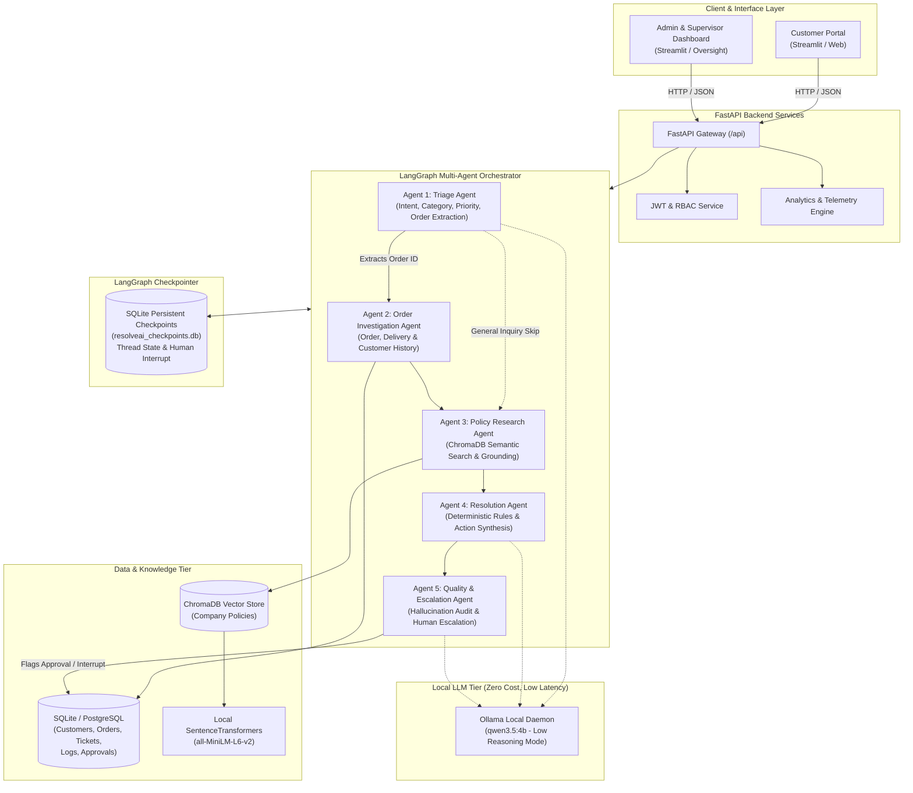
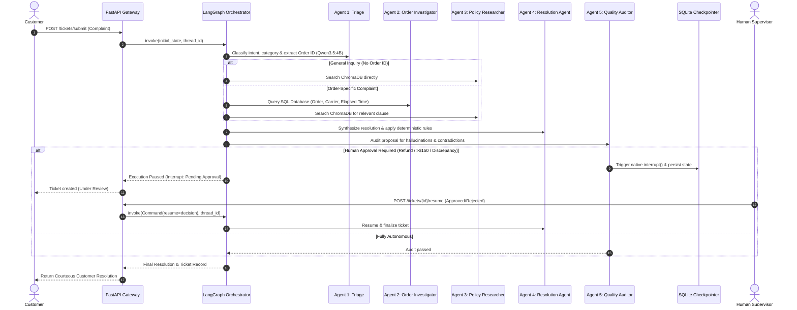

# ResolveAI System Architecture

## 1. High-Level System Architecture

ResolveAI is an enterprise-grade, autonomous multi-agent customer support resolution platform powered by **Local Qwen3.5:4B LLM (via Ollama)**, **LangGraph (with native interrupt)**, **ChromaDB (Local Embeddings)**, **FastAPI**, and **Streamlit**.

The system replaces rigid rule-based bots with five collaborative, specialized AI agents governed by deterministic business rules and human-in-the-loop safeguards.

## 2. Agent Workflow & Decision Pipeline

## 3. Core Architectural Highlights
1. **Local Privacy-First Inference**: All reasoning is executed locally by `qwen3.5:4b` hosted in Ollama. Customer PII and order data never leave the perimeter.
2. **Deterministic Business Rules**: Financial thresholds ($150+ approval), in-transit cancellation locks, and 30-day return windows are strictly enforced in Python code.
3. **LangGraph Native Interrupt & Resumption**: Checkpoints persisted in SQLite (`resolveai_checkpoints.db`) allow seamless workflow pausing and resumption across server restarts.
4. **Retrieval-Augmented Generation (RAG)**: ChromaDB with SentenceTransformers (`all-MiniLM-L6-v2`) provides vector similarity search across official policy clauses.
5. **Role-Based Access Control (RBAC)**: JWT authentication partitions Customer (`customer`) operations from Supervisor/Admin (`admin`) approval and audit dashboards.
